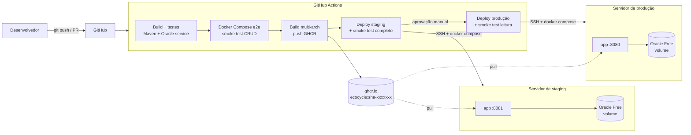
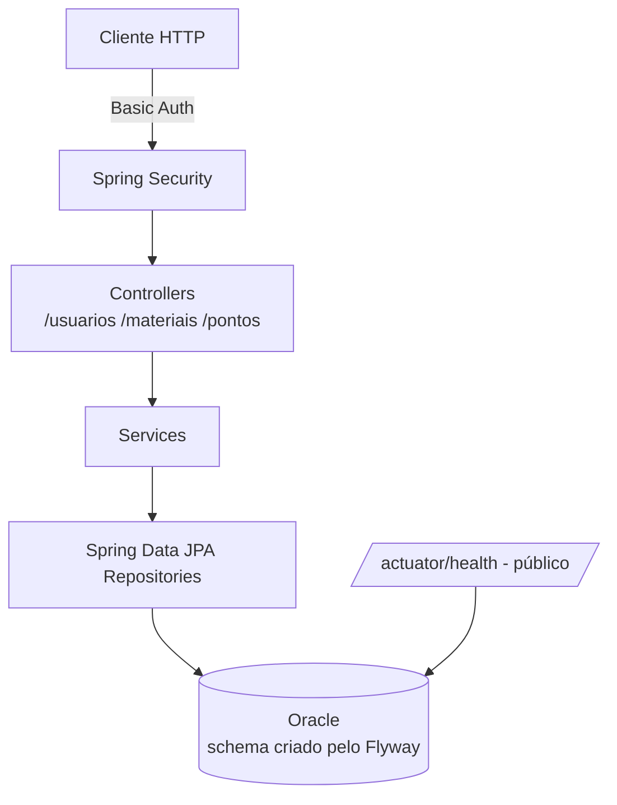

# EcoCycle

<!-- Depois de criar o repositório, adicione o badge do pipeline substituindo <usuario>/<repo>:
[](https://github.com/<usuario>/<repo>/actions/workflows/ci-cd.yml) -->

## Descrição

A **EcoCycle** é uma API REST em Spring Boot voltada ao pilar ambiental de ESG. Ela gerencia o
descarte consciente de resíduos: **usuários**, **materiais recicláveis** e **pontos de coleta**.

Este repositório também traz a esteira DevOps completa do projeto:
- build e testes automatizados;
- imagem Docker multi-stage;
- Docker Compose com Oracle;
- pipeline GitHub Actions com publicação no GHCR e deploy em **staging** e **produção**.

## Arquitetura



Fluxo de uma requisição dentro da aplicação:



Mais detalhes em [docs/01-arquitetura.md](docs/01-arquitetura.md).

## Tecnologias

| Camada | Tecnologia |
|---|---|
| Linguagem | Java 21 |
| Framework | Spring Boot 4.0.6 (Web MVC, Data JPA, Security, Validation, Actuator) |
| Banco | Oracle Database 23ai Free (`gvenzl/oracle-free`), driver `ojdbc11` |
| Migrations | Flyway (`spring-boot-starter-flyway` + `flyway-database-oracle`) |
| Build | Maven 3.9 (Maven Wrapper) |
| Testes | JUnit 5, Mockito, AssertJ, MockMvc, testes de integração com Oracle real |
| Containers | Docker (multi-stage) e Docker Compose |
| CI/CD | GitHub Actions, GitHub Environments e GitHub Container Registry (GHCR) |

## Pré-requisitos

- **Docker** 24+ com o plugin **Docker Compose v2** (Docker Desktop no Windows/macOS).
- Cerca de **3 GB de RAM livres** para o Oracle + aplicação.
- Opcional, para rodar fora do Docker: **JDK 21**. O Maven não é obrigatório, use o `./mvnw`.

## Configuração de ambiente

Nenhuma credencial fica no código. Toda a configuração vem de variáveis de ambiente.

```bash
cp .env.example .env      # Windows (PowerShell): Copy-Item .env.example .env
# edite o .env e defina senhas próprias
```

| Variável | Uso |
|---|---|
| `APP_PORT` | Porta publicada no host (padrão 8080) |
| `APP_IMAGE` | Imagem usada pelo Compose (local: `ecocycle-api:local`) |
| `APP_ENVIRONMENT` | `local`, `staging` ou `production` (aparece em `/actuator/info`) |
| `APP_SECURITY_USERNAME` / `APP_SECURITY_PASSWORD` | Usuário do Basic Auth da API |
| `ORACLE_PASSWORD` | Senha de SYS/SYSTEM do container Oracle |
| `DB_USERNAME` / `DB_PASSWORD` | Usuário/schema da aplicação (criado automaticamente no Oracle) |
| `DB_URL` | JDBC. No Compose: `jdbc:oracle:thin:@//oracle-db:1521/FREEPDB1` |
| `JAVA_OPTS` | Opções da JVM |
| `JPA_SHOW_SQL` | `true` para logar o SQL |
| `FLYWAY_BASELINE_ON_MIGRATE` | Mantenha `false` em banco novo |

> Use senhas **alfanuméricas** (letras e números), começando por uma letra. É o formato mais
> seguro para usuários Oracle e para o `.env`.

> ⚠️ **Segurança:** versões anteriores deste projeto tinham credenciais do Oracle da FIAP e do
> Spring Security escritas no `application.properties` e no README. Elas foram removidas, mas
> continuam no histórico e nos arquivos já compartilhados. **Troque a senha da conta Oracle da
> FIAP** e não reutilize a senha antiga da API.

## Execução local

**Opção 1: tudo em Docker (recomendado)**

```bash
docker compose up -d --build     # 1a vez: o Oracle leva alguns minutos para ficar saudável
docker compose ps                # aguarde app e oracle-db como "healthy"
curl http://localhost:8080/actuator/health
curl -u "$APP_SECURITY_USERNAME:$APP_SECURITY_PASSWORD" http://localhost:8080/usuarios
```

**Opção 2: aplicação na IDE ou com Maven, Oracle no Docker**

```bash
docker compose -f docker-compose.yml -f docker-compose.dev.yml up -d oracle-db
export DB_URL=jdbc:oracle:thin:@//localhost:1521/FREEPDB1 DB_USERNAME=ecocycle DB_PASSWORD=... \
       APP_SECURITY_USERNAME=admin APP_SECURITY_PASSWORD=...
./mvnw spring-boot:run
```

### Endpoints

Todos exigem Basic Auth, exceto o health.

| Recurso | Rotas |
|---|---|
| Usuários | `GET /usuarios`, `GET /usuarios/{id}`, `POST /usuarios`, `PUT /usuarios/{id}`, `DELETE /usuarios/{id}` |
| Materiais | `GET /materiais`, `GET /materiais/{id}`, `POST /materiais`, `PUT /materiais/{id}`, `DELETE /materiais/{id}` |
| Pontos de coleta | `GET /pontos`, `GET /pontos/{id}`, `POST /pontos`, `PUT /pontos/{id}`, `DELETE /pontos/{id}` |
| Health (público) | `GET /actuator/health` |
| Info | `GET /actuator/info` (autenticado) |

Exemplo:

```bash
curl -u admin:SUA_SENHA -H 'Content-Type: application/json' \
     -d '{"nome":"Ecoponto Centro","endereco":"Rua A, 10","tipoResiduo":"Vidro"}' \
     http://localhost:8080/pontos
```

## Docker

O [`Dockerfile`](Dockerfile) é **multi-stage** e compila a aplicação a partir do código-fonte:

| Stage | Imagem | Função |
|---|---|---|
| `build` | `maven:3.9-eclipse-temurin-21` | Baixa as dependências (camada em cache) e roda `mvn package` |
| runtime | `eclipse-temurin:21-jre` | Só o JRE 21 e o JAR, com usuário **não-root** `spring`, `HEALTHCHECK` em `/actuator/health` e `JAVA_OPTS` configurável |

```bash
docker build -t ecocycle-api:local .
```

O build não depende de um JAR compilado previamente na máquina. Detalhes em [docs/02-docker.md](docs/02-docker.md).

## Docker Compose

O [`docker-compose.yml`](docker-compose.yml) sobe dois serviços:

| Serviço | Imagem | Detalhes |
|---|---|---|
| `oracle-db` | `gvenzl/oracle-free:23-slim` | Volume `oracle-data` em `/opt/oracle/oradata`, healthcheck `healthcheck.sh`. Porta **não** exposta no host |
| `app` | build local ou `APP_IMAGE` (GHCR) | `depends_on: condition: service_healthy`. Conecta em `oracle-db:1521` pela rede interna |

- **Rede:** `ecocycle-net` (bridge). A aplicação resolve o banco pelo nome do serviço, nunca por `localhost`.
- **Volume:** `oracle-data` mantém os dados entre `docker compose down`/`up`. Para apagar os dados, use `docker compose down -v`.
- **Variáveis:** vêm do `.env`. As variáveis obrigatórias usam `${VAR:?mensagem}` e o Compose falha com uma mensagem clara se faltarem.
- **Desenvolvimento:** o [`docker-compose.dev.yml`](docker-compose.dev.yml) publica o Oracle em `127.0.0.1:1521`.

## Banco Oracle

- O banco roda em container com o **Oracle Database 23ai Free**. Não depende do Oracle da FIAP.
- Na primeira subida, o container cria o usuário/schema `DB_USERNAME` no PDB `FREEPDB1`.
- Ao iniciar, a aplicação roda o **Flyway**, que executa `src/main/resources/db/migration/V1__create_tables.sql`
  e cria `TB_USUARIO`, `TB_MATERIAL` e `TB_PONTO_COLETA`. Depois o Hibernate valida o schema (`ddl-auto=validate`).

Detalhes, incluindo as correções de mapeamento entidade × tabela, em [docs/03-banco-oracle.md](docs/03-banco-oracle.md).

## Testes

```bash
./mvnw test
```

| Tipo | Classes | Precisa de banco? |
|---|---|---|
| Unitários de Service (Mockito) | `UsuarioServiceTest`, `MaterialServiceTest`, `PontoDeColetaServiceTest` | Não |
| Controller (MockMvc standalone) | `UsuarioControllerTest`, `MaterialControllerTest`, `PontoDeColetaControllerTest` | Não |
| Integração (contexto completo, Flyway, segurança e CRUD) | `EcocycleApplicationTests`, `EcocycleIntegrationTests` | Sim. Rodam só quando `DB_URL` está definida; no CI o Oracle sobe como *service container* |

Sem banco, `mvn test` roda os testes unitários e ignora os de integração. Detalhes em [docs/06-testes.md](docs/06-testes.md).

## Pipeline CI/CD

Arquivos: [`.github/workflows/ci-cd.yml`](.github/workflows/ci-cd.yml) e [`deploy.yml`](.github/workflows/deploy.yml) (reutilizável).

| Job | Quando | O que faz |
|---|---|---|
| `build-test` | PR e push | Checkout, Java 21, cache Maven, compile, testes (com Oracle service), package, relatórios |
| `compose-e2e` | PR e push | `docker compose up --build --wait` + `scripts/smoke-test.sh` (health, 401 e CRUD) |
| `publish-image` | push na `main` | Build multi-arch (amd64/arm64) e push para o GHCR (`sha-<commit>` e `latest`) |
| `deploy-staging` | push na `main` com `DEPLOY_ENABLED=true` | SSH no servidor de staging, `docker compose pull/up --wait`, smoke test completo |
| `deploy-production` | depois do staging, com **aprovação manual** | Mesma imagem, SSH no servidor de produção, smoke test somente leitura |

**Versionamento da imagem:** cada commit da `main` gera `ghcr.io/<owner>/ecocycle:sha-<7 caracteres>`,
uma tag imutável. É **essa** tag que vai para staging e, depois de aprovada, para produção. A imagem
não é reconstruída entre os ambientes. A tag `latest` é só uma conveniência.

Detalhes em [docs/04-pipeline-ci-cd.md](docs/04-pipeline-ci-cd.md).

## Staging

- **GitHub Environment:** `staging`, sem aprovação.
- **Servidor:** VM própria com Docker, recomendada na Oracle Cloud Always Free (ver [docs/05-staging-producao.md](docs/05-staging-producao.md)).
- **Execução:** projeto Compose `ecocycle-staging`, com Oracle e volume próprios.
- **Validação:** smoke test **completo** (CRUD) depois de cada deploy.
- **URL:** _ainda não provisionada_. Será preenchida aqui após a criação do servidor.

## Produção

- **GitHub Environment:** `production`, com **Required reviewers**: o deploy só acontece após aprovação manual.
- **Servidor:** VM separada da de staging, com o projeto Compose `ecocycle-production` e Oracle e volume próprios.
- **Validação:** smoke test **somente leitura** (não cria dados em produção).
- **URL:** _ainda não provisionada_.

## Estrutura do projeto

```
ecocycle/
├── .github/workflows/
│   ├── ci-cd.yml              # pipeline principal
│   └── deploy.yml             # deploy reutilizável (staging/production)
├── docs/                      # documentação técnica (base do PDF/PPT) e evidências
├── scripts/
│   ├── deploy.sh              # executado no servidor via SSH
│   └── smoke-test.sh          # health + segurança + CRUD
├── src/main/java/br/com/fiap/ecocycle/
│   ├── config/                # SecurityConfig
│   ├── controller/            # REST controllers
│   ├── model/                 # entidades JPA
│   ├── repository/            # Spring Data JPA
│   └── service/               # regras de negócio
├── src/main/resources/
│   ├── application.properties # somente placeholders ${VAR}
│   └── db/migration/          # Flyway (V1__create_tables.sql)
├── src/test/java/...          # testes unitários, MockMvc e integração
├── .env.example               # modelo de variáveis (sem segredos)
├── Dockerfile                 # multi-stage Java 21
├── docker-compose.yml         # app + Oracle (rede, volume, healthchecks)
├── docker-compose.dev.yml     # override local (porta do Oracle)
└── pom.xml
```

## Evidências

Os prints e os links das execuções ficam em [docs/08-evidencias.md](docs/08-evidencias.md) e na pasta
`docs/evidencias/`. Só entram evidências de execuções reais.

## Checklist

| Requisito | Status |
|---|---|
| Build automatizado (GitHub Actions) | ✅ Implementado |
| Testes automatizados (unitários + integração com Oracle) | ✅ Implementado |
| Dockerfile funcional (multi-stage, Java 21, não-root, healthcheck) | ✅ Implementado |
| Docker Compose (app + Oracle, rede, volume, env, healthcheck) | ✅ Implementado |
| Publicação de imagem (GHCR, tag por commit) | ✅ Implementado |
| Deploy staging automático + smoke test | ⚠️ Implementado, depende do servidor e dos secrets |
| Deploy produção com aprovação manual | ⚠️ Implementado, depende do servidor, dos secrets e do Environment |
| README e documentação técnica (`docs/`) | ✅ |
| Evidências (prints) | ⚠️ A coletar após as execuções reais |

O checklist detalhado está em [docs/09-checklist.md](docs/09-checklist.md).
