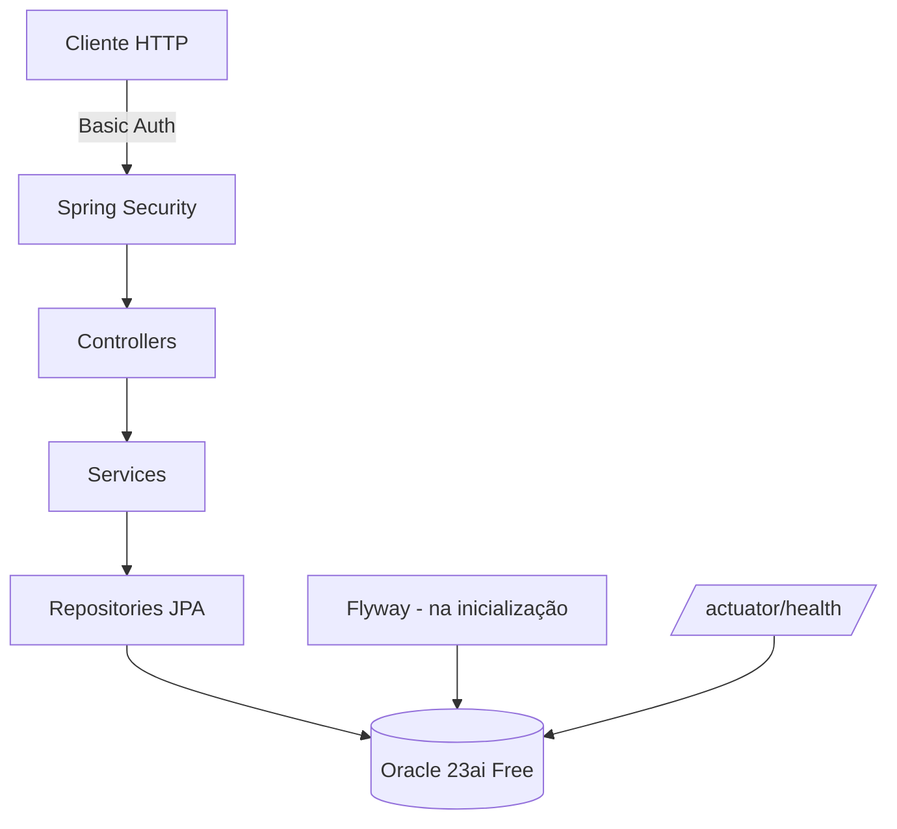
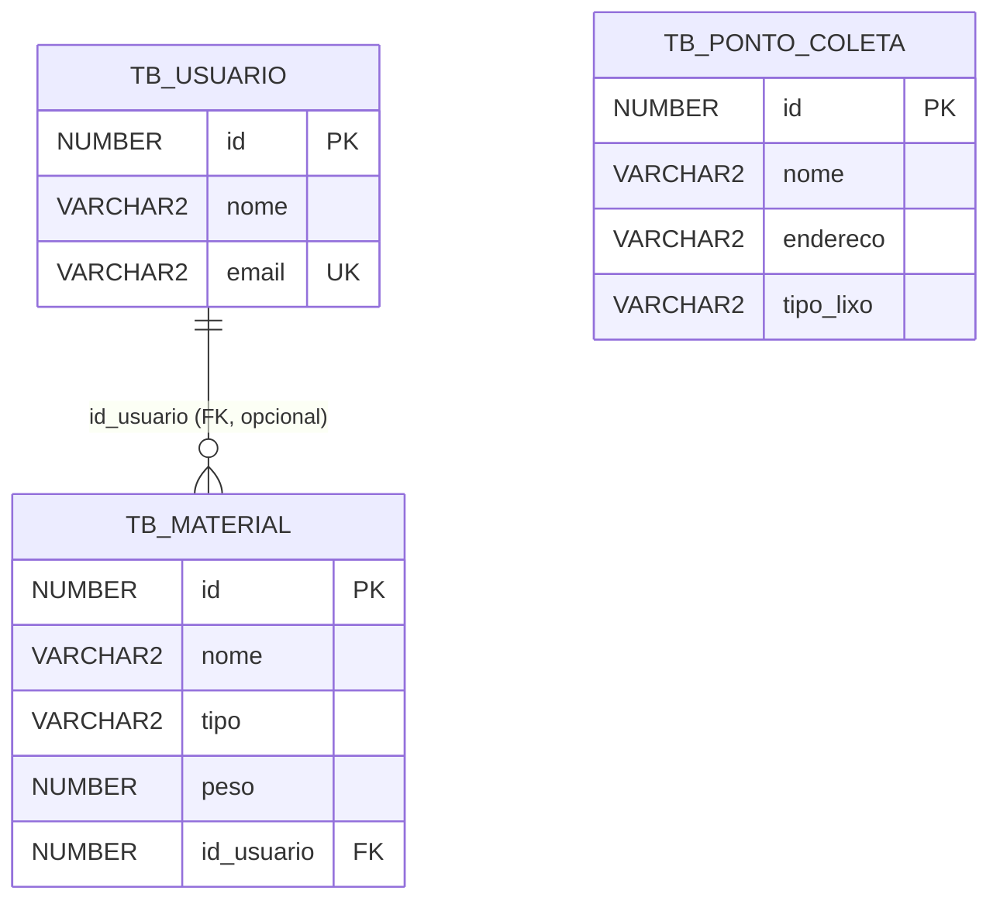
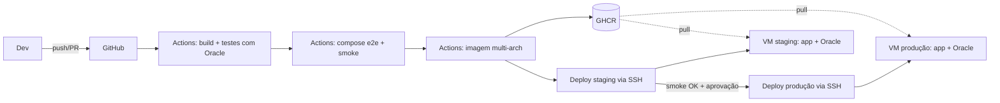

# 1. Arquitetura

## 1.1 Aplicação

A EcoCycle é uma API REST monolítica em camadas:

| Camada | Responsabilidade | Classes |
|---|---|---|
| Segurança | Basic Auth com usuário único definido por variável de ambiente; `/actuator/health` público | `SecurityConfig` |
| Controller | Rotas HTTP e códigos de status (200/201/204/404) | `UsuarioController`, `MaterialController`, `PontoDeColetaController` |
| Service | Regras de CRUD (buscar, salvar, atualizar, excluir) | `UsuarioService`, `MaterialService`, `PontoDeColetaService` |
| Repository | Acesso a dados com Spring Data JPA | `*Repository extends JpaRepository` |
| Persistência | Oracle; schema versionado pelo Flyway e validado pelo Hibernate | `V1__create_tables.sql` |
| Observabilidade | Spring Boot Actuator (`health`, `info`) | — |

Modelo de dados (criado pela migration V1):

## 1.2 Infraestrutura e entrega

**Princípios adotados:**
- **Build once, deploy many:** a mesma imagem (`sha-<commit>`) passa por CI, staging e produção.
- **Configuração externa:** o código não muda entre ambientes, só o `.env` e os Secrets.
- **Isolamento:** cada ambiente tem servidor, banco, volume e rede próprios.
- **Portões de qualidade:** testes → e2e → staging + smoke → aprovação humana → produção.
