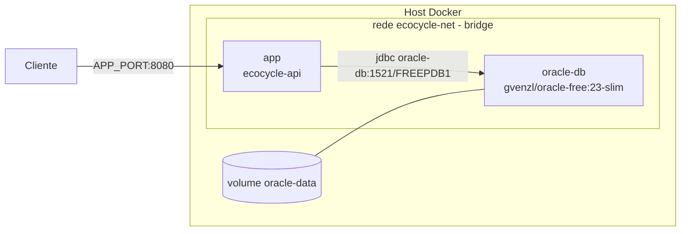

# 2. Docker e Docker Compose

## 2.1 Dockerfile (multi-stage)

| Aspecto | Antes | Depois |
|---|---|---|
| Imagem base | `openjdk:17-jdk-slim` (descontinuada, Java 17) | `maven:3.9-eclipse-temurin-21` (build) + `eclipse-temurin:21-jre` (runtime) |
| Versão Java | 17, incompatível com o bytecode Java 21 (`UnsupportedClassVersionError`) | 21 nos dois estágios |
| Origem do JAR | `COPY target/*.jar`, exigia build manual antes | Compilado dentro do `docker build`, a partir do código-fonte |
| Usuário | root | `spring` (não-root) |
| Health | nenhum | `HEALTHCHECK` com `curl /actuator/health` |
| Configuração | nenhuma, credenciais dentro do JAR | Variáveis de ambiente (`DB_*`, `APP_SECURITY_*`, `JAVA_OPTS`...) |
| Contexto de build | sem `.dockerignore` | `.dockerignore` envia só `pom.xml` e `src/` |

**Otimizações:**
- O `pom.xml` é copiado antes do `src/`, então a camada de dependências fica em cache.
- `RUN --mount=type=cache,target=/root/.m2` reaproveita o repositório Maven entre builds.
- `FROM --platform=$BUILDPLATFORM` no estágio de build: o JAR é independente de arquitetura,
  então o Maven roda nativo mesmo quando a imagem final é gerada para `arm64`.
- `ENTRYPOINT ["sh","-c","exec java $JAVA_OPTS -jar /app/app.jar"]`: a JVM vira o PID 1 e recebe o SIGTERM.

## 2.2 Docker Compose



| Requisito | Implementação |
|---|---|
| Aplicação + banco | serviços `app` e `oracle-db` |
| Rede | `ecocycle-net` (bridge). DNS interno pelo nome do serviço |
| Volume | `oracle-data` → `/opt/oracle/oradata` (dados persistentes) |
| Variáveis de ambiente | `.env` (modelo em `.env.example`). Obrigatórias validadas com `${VAR:?}` |
| Healthcheck | Oracle: `healthcheck.sh`. App: `curl /actuator/health` |
| Ordem de subida | `depends_on: oracle-db: condition: service_healthy` |
| Exposição | Só a aplicação publica porta. O Oracle fica restrito à rede interna |
| Multi-ambiente | `docker compose -p ecocycle-staging` / `-p ecocycle-production` isola containers, rede e volume |

**Comandos:**

```bash
docker compose config                 # valida o arquivo e as variáveis
docker compose up -d --build --wait   # sobe e espera os healthchecks
docker compose ps                     # estado (healthy)
docker compose logs -f app            # logs (inclui o Flyway)
docker compose down                   # para (mantém os dados)
docker compose down -v                # para e APAGA o volume do Oracle
```
