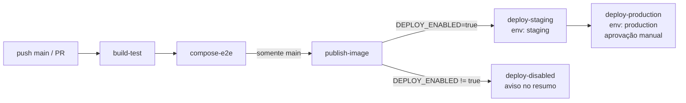

# 4. Pipeline CI/CD (GitHub Actions)

## 4.1 Visão geral

## 4.2 Jobs

| Job | Etapas |
|---|---|
| `build-test` | Checkout → `setup-java` 21 (Temurin) com **cache Maven** → `mvnw compile` → `mvnw test` com Oracle como *service container* (testes de integração reais) → `mvnw package` → resumo dos testes no *Job Summary* → artefatos (relatórios Surefire e JAR) |
| `compose-e2e` | `.env` efêmero → `docker compose config` → `docker compose up --build --wait` (imagem construída pelo Dockerfile) → lista containers/rede/volume → `scripts/smoke-test.sh` (health, 401, CRUD nos 3 recursos) → evidência do Flyway nos logs → `down -v` |
| `publish-image` | QEMU + Buildx → login no GHCR com `GITHUB_TOKEN` → build **linux/amd64 + linux/arm64** → push com as tags `sha-<commit>` e `latest` → cache GHA |
| `deploy-staging` | Chama `deploy.yml` com `environment: staging` e *smoke* completo |
| `deploy-production` | Chama `deploy.yml` com `environment: production` e *smoke* somente leitura. Espera a aprovação do Environment |

`deploy.yml` (reutilizável): valida os secrets → configura a chave SSH → monta o `.env` a partir dos
Secrets do Environment → envia `docker-compose.yml` e os scripts via `scp` → `deploy.sh`
(`docker compose pull` + `up -d --no-build --wait`) → smoke test no servidor → verificação externa
opcional (`APP_URL`) → resumo.

## 4.3 Segredos

Nenhum segredo está no YAML:
- O banco de CI é efêmero, existe só dentro do runner, e suas senhas são geradas por execução (`github.run_id`).
- As credenciais de staging e produção vêm de **Environment Secrets** (cada ambiente tem os seus).
- O push no GHCR usa o `GITHUB_TOKEN` automático, com permissão `packages: write` só nesse job.

## 4.4 Versionamento das imagens

| Tag | Exemplo | Uso |
|---|---|---|
| `sha-<7>` | `ghcr.io/<owner>/ecocycle:sha-1a2b3c4` | **Imutável.** É a tag usada nos deploys; rastreável até o commit |
| `latest` | `ghcr.io/<owner>/ecocycle:latest` | Conveniência (última build da `main`). Não é usada em deploy |

**Rollback:** reexecutar os jobs de deploy de uma execução anterior (*Re-run jobs*), que aponta
para a tag `sha-` antiga. Como os dados ficam no volume do Oracle, eles são preservados.

## 4.5 Gatilhos e proteções

- Os PRs rodam `build-test` + `compose-e2e`, servindo de *quality gate* antes do merge.
- `concurrency` cancela execuções antigas de PR, mas nunca interrompe um deploy da `main`.
- Os deploys exigem `vars.DEPLOY_ENABLED == 'true'`. Sem infraestrutura, os jobs aparecem como
  *skipped* e o resumo explica o motivo. Não há deploy simulado.
- Recomendado (configuração manual): *branch protection* na `main` exigindo os checks `Build e testes`
  e `Docker Compose (app + Oracle) e smoke test`.
